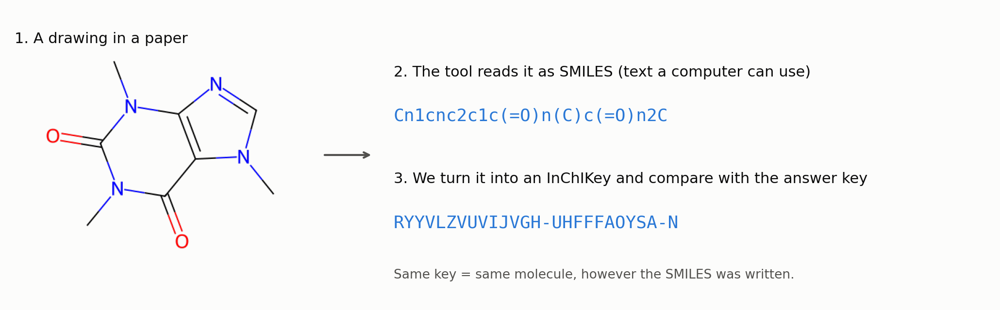
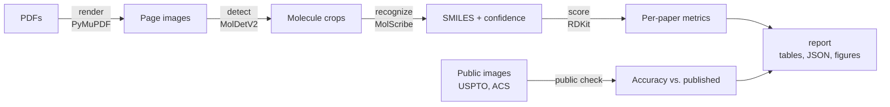

<div align="center">

# MolCensus

**Count every molecule drawn in a paper, then check which ones each tool finds.**

A benchmark for tools that read chemical structure drawings in scientific PDFs and turn them into
machine-readable chemistry.

[](https://github.com/meshivanshsinghh/molcensus/actions/workflows/tests.yml)


[](LICENSE)

[The idea](#the-idea-in-one-minute) · [Results](#results-so-far) · [How it works](#how-it-works) · [Quick start](#quick-start) · [Roadmap](#status-and-roadmap)

</div>

---

## The idea in one minute

Chemistry papers show molecules as drawings. A computer can't search or compare a drawing, so tools
called OCSR (optical chemical structure recognition) read each drawing and write it out as SMILES, a
line of text that describes the molecule.



Most OCSR tools are tested on single, clean drawings cut out of patents. Real papers are messier.
Molecules sit inside reaction schemes and tables, and a whole series of compounds is often defined
in a table ("R1 = methyl, ethyl, ...") instead of being drawn. MolCensus tests the tools on whole
papers: it renders every page, finds the drawings, runs a tool on each one, and checks the answers
against a hand-made list of every molecule in the paper.

| Term | Meaning here |
|---|---|
| Crop | One molecule drawing cut out of a page |
| SMILES | Text form of a molecule, for example `CCO` for ethanol |
| InChIKey | A fixed-length ID for a molecule. Two SMILES for the same molecule give the same key |
| Recall | Share of the paper's molecules the tool found |
| Precision | Share of the tool's answers that are molecules from the paper |
| Tanimoto | Similarity between two molecules, from 0 to 1. Gives credit for near misses |
| 95% interval | The range the true value likely falls in, given how few molecules there are |

## Results so far

So far the benchmark covers MolDetV2 (the molecule detector inside BioMiner) together with
MolScribe (the reader), on six course papers with 219 unique molecules. BioMiner end to end is
wired in but needs a 24 GB GPU, which I am waiting on from the course.


On clean public crops MolScribe matches its published accuracy: 0.922 on USPTO patent images
(published 0.926) and 0.731 on ACS journal images (published 0.719). On whole papers it finds 51 of
the 219 molecules exactly, a recall of 0.233 (95% interval 0.182 to 0.293 over molecules, and 0.169
to 0.493 over papers).


The breakdown above shows where the rest went. Paper 1 draws all its molecules in full and MolScribe
finds 13 of 17. Papers 4 and 19 hold most of the molecules, but they define them through R-group
tables, so the finished compounds are never drawn. For 127 of the missed molecules MolScribe did read
a related structure from the same paper (Tanimoto 0.5 to 0.85). In paper 19, three drawings of a
core with R-group placeholders were the closest match for 59 of its 82 such molecules. Only 20
molecules had nothing similar read at all.

Getting here also turned up a bug. MolScribe returned `<invalid>` for every drawing with an
abbreviation such as `Me` or `Ph` when run on macOS, which made its ACS accuracy look like 0.348.
The public check caught it, and a three-line patch fixed it
([details](docs/methods.md#a-molscribe-bug-the-check-caught)).

Every number, with its interval, is in [results/RESULTS.md](results/RESULTS.md). The full run takes
about 40 minutes on a laptop CPU (Apple M5); package versions are in `results/environment.json`.

## How it works



Each step writes files that the next one reads, so any step can be rerun on its own. Molecules are
matched by InChIKey (exact match) and by its first block (ignoring stereochemistry). Because crops
don't line up one-to-one with the answer list, each paper is scored as two sets of unique molecules.
The definitions are in [docs/methods.md](docs/methods.md).

## Quick start

```bash
git clone https://github.com/meshivanshsinghh/molcensus.git
cd molcensus
uv venv --python 3.10 && source .venv/bin/activate
uv pip install -r requirements.txt
```

The six course PDFs and their ground truth are private and not in this repository (see
[data/README.md](data/README.md)). With them in `data/`:

```bash
python run_pipeline.py                                   # everything, about 40 minutes on CPU
python run_pipeline.py --papers 16 --steps prepare,render,detect,recognize,score,report  # quick test
```

Without them you can still run the public check, which downloads MolScribe's evaluation images once
(184 MB), and the tests:

```bash
python run_pipeline.py --steps public,report
pytest -q
```

Settings, outputs, adding a tool, enabling BioMiner and troubleshooting are in
[docs/usage.md](docs/usage.md).

## Repository layout

```
run_pipeline.py       runs the steps in order
configs/              settings: default.yaml, and embedded.yaml for the detection comparison
src/molcensus/
  render.py           PDF pages to images
  detect.py           MolDetV2 detection and cropping
  recognizers/        one wrapper per tool (MolScribe, BioMiner), same output columns
  chem.py, metrics.py InChIKeys, fingerprints, scores and intervals
  public_crops.py     the public check on USPTO and ACS images
  report.py           tables, JSON and RESULTS.md
  figures.py          the charts
tests/                unit tests (run on every push)
results/              committed metrics and figures, no private SMILES
docs/                 methods and usage
```

## Status and roadmap

| | |
|---|---|
| Done | Pipeline from PDF to scores, public check, 95% intervals, per-molecule outcome breakdown |
| Done | Fix for MolScribe's abbreviation bug, with a test |
| Waiting | BioMiner end to end (needs a 24 GB GPU; course GPU access requested) |
| Next | A second reader, MolSight or MolNexTR, on the same crops |
| Next | Detection comparison against images embedded in the PDFs (`configs/embedded.yaml`) |
| Later | Hand-drawn boxes, so detection can be scored apart from reading |
| Later | A filter for crops that are not whole molecules, such as R-group table cells |
| Later | More public sets (CLEF, UOB, Staker) and BioVista papers |
| Later | Report the MolScribe bug upstream |

## Background

Built for AAI 6630 Applied Computer Vision (Northeastern University, Fall 2026) as part of the XN
project on extracting chemical structures from papers. Author: Shivansh Singh.

## References

- Gulluoglu, H. S. A., et al. (2026). Practical use of advanced AI frameworks on real-life scientific problems: Three case studies. *bioRxiv*. https://doi.org/10.64898/2026.06.23.734132
- Heller, S. R., McNaught, A., Pletnev, I., Stein, S., & Tchekhovskoi, D. (2015). InChI, the IUPAC International Chemical Identifier. *Journal of Cheminformatics, 7*, 23. https://doi.org/10.1186/s13321-015-0068-4
- Qian, Y., Guo, J., Tu, Z., Li, Z., Coley, C. W., & Barzilay, R. (2023). MolScribe: Robust molecular structure recognition with image-to-graph generation. *Journal of Chemical Information and Modeling, 63*(7), 1925–1934. https://doi.org/10.1021/acs.jcim.2c01480
- Yan, J., et al. (2026). BioMiner: A multi-modal system for automated mining of protein-ligand bioactivity data from literature. *arXiv*. https://arxiv.org/abs/2604.21508
- MolDetV2 weights: https://huggingface.co/UniParser/MolDetv2 · Public check images: https://huggingface.co/yujieq/MolScribe (`real.zip`)

## License

MIT (see [LICENSE](LICENSE)). The models keep their own licenses: MolScribe and BioMiner are MIT;
the MolDetV2 weights are for non-commercial use only.
