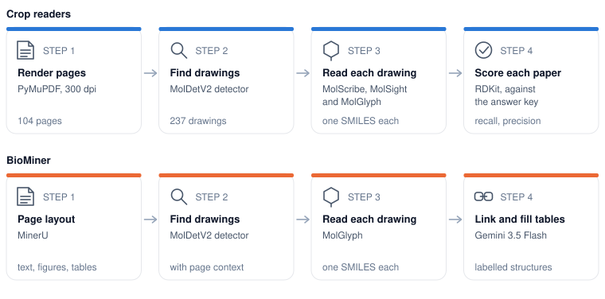
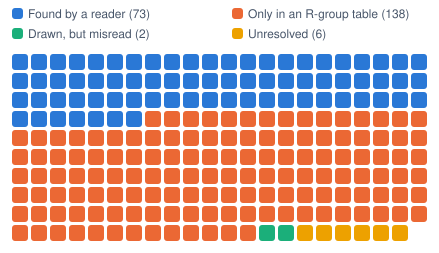
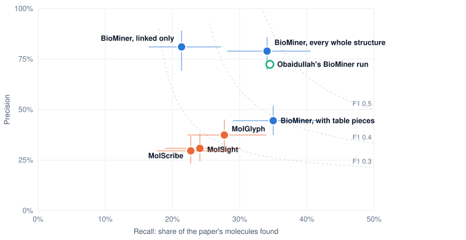

# MolCensus

[](https://github.com/meshivanshsinghh/MolCensus/actions/workflows/tests.yml)
[](https://meshivanshsinghh.github.io/MolCensus/)
[](LICENSE)


MolCensus measures how well tools that read chemical structure drawings work on whole research papers. These
tools, called OCSR tools (optical chemical structure recognition), turn a drawing into SMILES, a line of text that
spells out a molecule's atoms and bonds. They are usually scored on single drawings already cut out of patents,
where the best of them are right more than nine times in ten. Medicinal chemistry papers are harder: molecules sit
inside reaction schemes, and a whole series of compounds is often printed once, as a shared core with a table of
substituents. MolCensus renders every page, finds the drawings, runs each tool, and compares the result with a list
of every molecule the paper reports. Then it traces every molecule the tools missed to a cause.

**[Read the report](https://meshivanshsinghh.github.io/MolCensus/)** for the findings, the charts and how the work was done.

<p align="center"></p>

## Key results

The main test set is six medicinal chemistry papers from a Northeastern University course, with 220 distinct
molecules. Their answer key is private, so everything here is a total per paper.

<p align="center"></p>

- **Crop readers hit a ceiling set by the papers, not by reading.** MolScribe, MolSight and MolGlyph together found
  73 of 219 molecules. Of the 146 they missed, 138 exist only as rows of R-group tables, so a reader that works one
  drawing at a time can reach at most 34% to 37% recall here.
- **BioMiner's table step finds what crop readers cannot.** Counting every whole structure BioMiner reads gives
  34.1% recall at 78.9% precision, and its table step found 12 molecules no crop reader found. It ran with Gemini 3.5
  Flash on Google Cloud Vertex AI, not with its own BioMiner-Instruct model.
- **On BioVista, most of BioMiner's shortfall is linking.** For fully drawn structures, counting what its reader found
  but the language model did not link raises mean recall from 36.1% to 59.4%, against 65.4% published.
- **Public benchmarks rank the readers differently.** MolScribe is best on USPTO patent images and MolGlyph on the
  course papers. How tautomers are scored moves MolScribe's UOB score from 95.9% to 87.3%, and under the stricter
  rule our numbers equal a teammate's run on the same images.
- **Every major failure was silent.** A macOS bug in MolScribe, a cuDNN mix-up on the GPU, a crash that exited with
  success and a free-tier Gemini quota all ran to the end without an error; known-answer checks caught each one.

<p align="center"></p>

## What is in the repository

| Path | Contents |
|---|---|
| `run_pipeline.py` | Runs the pipeline steps in order: prepare, render, detect, recognize, score, public, report |
| `configs/` | Settings: `default.yaml` for a laptop, `aws*.yaml` for the GPU runs |
| `src/molcensus/` | Page rendering, MolDetV2 detection, one wrapper per reader, scoring with intervals, reports |
| `scripts/aws/` | Setup and run scripts for one AWS GPU instance, with a step-by-step guide |
| `scripts/analysis/` | The analyses behind the write-ups: BioMiner run facts and scores, the recall ceiling, follow-up tests |
| `scripts/report/` | `collect.py` gathers the report's numbers; `build_site.py` builds the page and the figures above |
| `docs/` | The report page, [methods](docs/methods.md), [usage](docs/usage.md) and a write-up of each GPU run |
| `results/` | Metrics and figures from the laptop run; no SMILES for the private papers |
| `tests/` | Unit tests, run on every push |


## Quick start

Python 3.10 is required, because MolScribe pins older libraries.

```bash
git clone https://github.com/meshivanshsinghh/MolCensus.git
cd MolCensus
uv venv --python 3.10 && source .venv/bin/activate
uv pip install -r requirements.txt
pytest -q
```

The public-set benchmark needs no private data. It downloads MolScribe's evaluation images once (184 MB) and the
MolScribe weights (1.1 GB), then scores MolScribe on fixed samples of 300 USPTO and 300 ACS images against the
published accuracy:

```bash
python run_pipeline.py --steps public,report
```

The scores land in `results/public/public_metrics.csv` and `results/RESULTS.md`. With the course papers and their
answer key in `data/` (see [data/README.md](data/README.md)), `python run_pipeline.py` runs everything. The report
page and its figures rebuild from the committed data file with `python scripts/report/build_site.py`. Settings,
outputs and adding a reader are covered in [docs/usage.md](docs/usage.md).

## Data

The six course papers and their answer key are not in this repository or its history. The papers are copyrighted
journal articles, and the answer key is private sponsor data shared through AAI 6630. No file in the repository holds
a SMILES string, a drawing or a compound name from them.

The public data is downloaded on first use and never committed:

| Data | Source | Terms |
|---|---|---|
| USPTO, UOB, CLEF, ACS and Staker images | MolScribe's evaluation archive `real.zip`, Hugging Face repository `yujieq/MolScribe` | MIT license on the repository; the images come from their original publishers |
| BioVista: 8,861 labelled crops and per-paper structure labels | The Google Drive links in [BioMiner's README](https://github.com/jiaxianyan/BioMiner) (Yan et al., 2026) | As set by the BioVista authors; downloaded by hand into `data/biovista/` |

Model weights are downloaded into `models/`: MolScribe (`yujieq/MolScribe`), MolSight-base (`Robert-zwr/MolSight`),
MolGlyph (`jiaxianustc/MolGlyph`, gated, so accept its terms on Hugging Face first) and MolDetV2
(`UniParser/MolDetv2`, for non-commercial use only). Each keeps its own license.

## Reproducing the GPU run

MolSight, MolGlyph and BioMiner need a GPU with 24 GB of memory. [scripts/aws/README.md](scripts/aws/README.md) sets
up one AWS instance step by step: `setup.sh` installs every tool and checks each one on known inputs, and
`run_all.sh` runs the stages, uploads the results to S3 and stops the instance. BioMiner also needs a Google Cloud
project with Vertex AI; the guide connects the instance to it through workload identity federation, so no key is
stored on the instance. Both GPU runs together cost about $25 at list price. The guide uses placeholders for every
account-specific value.

## Credits

MolCensus was built by Shivansh Singh for AAI 6630, Applied Computer Vision, at Northeastern University (fall 2026).
Teammates Muhammad Obaidullah and Maljha Fatima Syeda ran the group's multi-reader, whole-PDF and BioVista benchmarks;
the report compares our numbers with theirs and credits them there.

The tools: [MolScribe](https://github.com/thomas0809/MolScribe) (Qian et al., 2023),
[MolSight](https://github.com/hustvl/MolSight), [MolGlyph and BioMiner](https://github.com/jiaxianyan/BioMiner)
(Yan et al., 2026), [MolDetV2](https://huggingface.co/UniParser/MolDetv2), [RDKit](https://www.rdkit.org), MinerU
and PyMuPDF.

- Qian, Y., Guo, J., Tu, Z., Li, Z., Coley, C. W., and Barzilay, R. (2023). MolScribe: Robust molecular structure
  recognition with image-to-graph generation. *Journal of Chemical Information and Modeling, 63*(7), 1925-1934.
  https://doi.org/10.1021/acs.jcim.2c01480
- Yan, J., et al. (2026). BioMiner: A multi-modal system for automated mining of protein-ligand bioactivity data from
  literature. *arXiv*. https://arxiv.org/abs/2604.21508
- Heller, S. R., McNaught, A., Pletnev, I., Stein, S., and Tchekhovskoi, D. (2015). InChI, the IUPAC International
  Chemical Identifier. *Journal of Cheminformatics, 7*, 23. https://doi.org/10.1186/s13321-015-0068-4
- Gulluoglu, H. S. A., et al. (2026). Practical use of advanced AI frameworks on real-life scientific problems: Three
  case studies. *bioRxiv*. https://doi.org/10.64898/2026.06.23.734132

## Citation

```bibtex
@software{singh2026molcensus,
  author = {Singh, Shivansh},
  title  = {MolCensus: chemical structure recognition benchmarked on whole research papers},
  year   = {2026},
  url    = {https://github.com/meshivanshsinghh/MolCensus}
}
```

## License

MIT, see [LICENSE](LICENSE). The models and data sets keep their own licenses.
