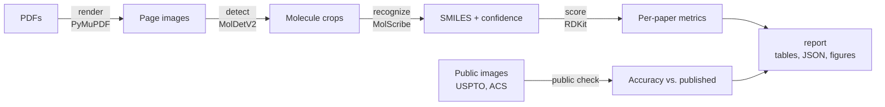

# MolCensus

[](https://github.com/meshivanshsinghh/molcensus/actions/workflows/tests.yml)

[](LICENSE)

**Count every molecule drawn in a paper, then check which ones each tool finds.**

MolCensus benchmarks optical chemical structure recognition (OCSR) tools on whole scientific PDFs.
It renders each page, finds the molecule drawings, turns each one into SMILES, and scores the result
against a list of the molecules the paper actually contains.

Most published OCSR scores come from clean, cropped patent images. Real papers draw molecules inside
schemes, tables and annotated figures, and define whole compound series through R-group tables.
MolCensus measures tools on the papers themselves.


## Findings so far

MolDetV2 (detection) with MolScribe (recognition), on six course papers with 219 unique molecules:

- **The installation is verified.** MolScribe matches its published accuracy on public sets:
  0.922 on USPTO patents (published 0.926) and 0.731 on ACS journal figures (published 0.719).
- **Whole papers are much harder than crops.** Pooled exact recall is 0.233 (51 of 219), with a
  95% interval of 0.182 to 0.293 over molecules and 0.169 to 0.493 over papers.
- **How a paper presents its compounds decides the ceiling.** Paper 1 draws every molecule in full
  and reaches 0.765. Papers 4 and 19 hold 164 of the 219 molecules but define most of them through
  R-group tables and placeholders, and stay at 0.18 and 0.16.
- **The public check caught a real bug.** MolScribe silently returned `<invalid>` for every drawing
  with an abbreviation like `Me` or `Ph` on macOS. A three-line patch fixed it: ACS accuracy went
  from 0.348 to 0.731. Details in [docs/methods.md](docs/methods.md#a-molscribe-bug-the-check-caught).


All numbers, with intervals, are in [results/RESULTS.md](results/RESULTS.md). The run took about 37
minutes on CPU (Apple M5, Python 3.10); package versions are in `results/environment.json`.

## How it works



Each step writes files the next one reads, so any step can be rerun alone. Molecules are matched by
InChIKey (exact) and by its first block (ignoring stereochemistry), with Tanimoto similarity for near
misses. Every rate gets a 95% Wilson interval and a bootstrap interval over papers.
See [docs/methods.md](docs/methods.md) for the full definitions.

## Quick start

```bash
git clone https://github.com/meshivanshsinghh/molcensus.git
cd molcensus
uv venv --python 3.10 && source .venv/bin/activate
uv pip install -r requirements.txt
```

The six course PDFs and their ground truth are private and not in this repository (see
[data/README.md](data/README.md)). With them in `data/`:

```bash
python run_pipeline.py                                   # everything, about 40 minutes on CPU
python run_pipeline.py --papers 16 --steps prepare,render,detect,recognize,score,report  # quick test
```

Without them, the public check still runs. It downloads MolScribe's public evaluation images once
(184 MB):

```bash
python run_pipeline.py --steps public,report
pytest -q
```

Configuration, outputs, adding a tool, BioMiner and troubleshooting are in
[docs/usage.md](docs/usage.md).

## Repository layout

```
run_pipeline.py          entry point: runs the steps in order
configs/                 all settings (default run, embedded-image detection)
src/molcensus/           render, detect, recognizers/, chem, metrics, public_crops, report
tests/                   scoring, intervals and the MolScribe patch
results/                 committed metrics and figures (no private SMILES)
docs/                    methods and usage
```

## Status and roadmap

| | Item |
|---|---|
| Done | End-to-end pipeline: render, detect, recognize, score, report |
| Done | Public crop check against published accuracy (USPTO, ACS) |
| Done | Wilson and paper-bootstrap 95% intervals on every rate |
| Done | Fix for MolScribe's abbreviation bug, with a test |
| Next | BioMiner end to end, which adds R-group enumeration (wired in, needs a 24 GB GPU) |
| Next | A second recognizer, MolSight or MolNexTR, on the same crops |
| Next | Error breakdown per paper: stereo-only misses, near misses, no candidate |
| Next | Detection comparison against embedded PDF images (`configs/embedded.yaml`, not run yet) |
| Later | Hand-drawn detection boxes, so detection can be scored separately from recognition |
| Later | A filter for crops that are not clean molecules (confidence alone is not enough) |
| Later | More public sets (CLEF, UOB, Staker) and the BioVista set of whole papers |
| Later | Recognizer registry, `pyproject.toml` with a `molcensus` command, W&B dashboard |
| Later | Report the MolScribe bug and fix upstream |

## Background

Built for AAI 6630 Applied Computer Vision (Northeastern University, Fall 2026) as part of the XN
project on extracting chemical structures from papers. Author: Shivansh Singh.

## References

- Gulluoglu, H. S. A., et al. (2026). Practical use of advanced AI frameworks on real-life scientific problems: Three case studies. *bioRxiv*. https://doi.org/10.64898/2026.06.23.734132
- Heller, S. R., McNaught, A., Pletnev, I., Stein, S., & Tchekhovskoi, D. (2015). InChI, the IUPAC International Chemical Identifier. *Journal of Cheminformatics, 7*, 23. https://doi.org/10.1186/s13321-015-0068-4
- Qian, Y., Guo, J., Tu, Z., Li, Z., Coley, C. W., & Barzilay, R. (2023). MolScribe: Robust molecular structure recognition with image-to-graph generation. *Journal of Chemical Information and Modeling, 63*(7), 1925–1934. https://doi.org/10.1021/acs.jcim.2c01480
- Tang, H., Dang, X., & Wang, J. (2026). Fine-tuning DeepSeek-OCR-2 for molecular structure recognition. *arXiv*. https://arxiv.org/abs/2604.03476
- Yan, J., et al. (2026). BioMiner: A multi-modal system for automated mining of protein-ligand bioactivity data from literature. *arXiv*. https://arxiv.org/abs/2604.21508
- MolDetV2 weights: https://huggingface.co/UniParser/MolDetv2 · Public check images: https://huggingface.co/yujieq/MolScribe (`real.zip`)

## License

MIT (see [LICENSE](LICENSE)). The models keep their own licenses: MolScribe and BioMiner are MIT;
the MolDetV2 weights are for non-commercial use only.
