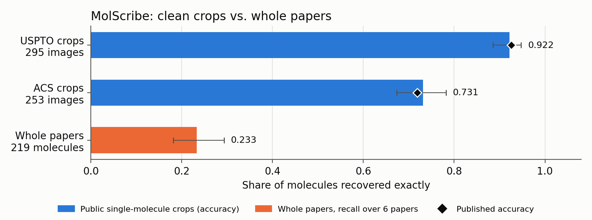
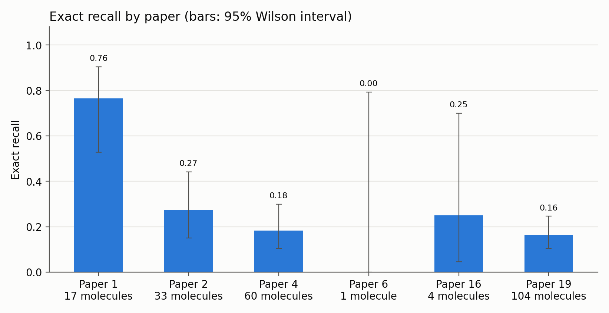
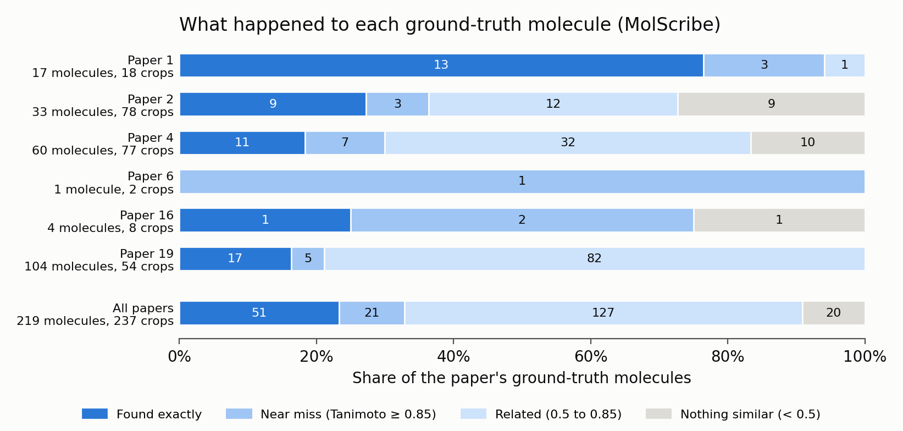

# MolCensus results

Generated 2026-10-20T13:11:19+00:00 with detection method `moldet`. Rates are pooled over the papers unless noted. Brackets are 95% intervals: a Wilson interval over molecules, then a bootstrap over papers. Definitions are in docs/methods.md.

## Course papers: overall

| metric | molscribe |
|---|---|
| Exact recall | 0.233 [0.182, 0.293]; papers [0.169, 0.493] |
| Exact precision | 0.302 [0.238, 0.375]; papers [0.185, 0.515] |
| Stereo-blind recall | 0.233 [0.182, 0.293]; papers [0.169, 0.493] |
| Valid SMILES rate | 0.932 |
| Mean best Tanimoto | 0.744 |
| Predictions / unique GT molecules | 237 / 219 |

## Course papers: exact recall by paper

| paper | unique GT molecules | molscribe |
|---|---|---|
| 1 | 17 | 0.765 [0.527, 0.904] |
| 2 | 33 | 0.273 [0.151, 0.442] |
| 4 | 60 | 0.183 [0.106, 0.299] |
| 6 | 1 | 0.000 [0.000, 0.793] |
| 16 | 4 | 0.250 [0.046, 0.699] |
| 19 | 104 | 0.163 [0.105, 0.246] |

## What happened to each ground-truth molecule

Each unique molecule is counted once, in its best outcome. A near miss has a prediction with Tanimoto at least 0.85; a related molecule is between 0.5 and 0.85.

| paper | unique GT molecules | found exactly | right except stereo | near miss | related molecule read | nothing similar read |
|---|---|---|---|---|---|---|
| 1 | 17 | 13 | 0 | 3 | 1 | 0 |
| 2 | 33 | 9 | 0 | 3 | 12 | 9 |
| 4 | 60 | 11 | 0 | 7 | 32 | 10 |
| 6 | 1 | 0 | 0 | 1 | 0 | 0 |
| 16 | 4 | 1 | 0 | 2 | 0 | 1 |
| 19 | 104 | 17 | 0 | 5 | 82 | 0 |
| ALL | 219 | 51 | 0 | 21 | 127 | 20 |

## Public crop check

Public single-molecule images with known SMILES (MolScribe's evaluation sets). The check passes when the published accuracy falls inside our 95% interval.

| tool / dataset | images | exact accuracy [95% CI] | published | published inside CI | stereo-blind accuracy | chiral exact (n) | valid SMILES | mean Tanimoto | seconds / image |
|---|---|---|---|---|---|---|---|---|---|
| molscribe / ACS | 253 | 0.731 [0.673, 0.782] | 0.719 | yes | 0.798 | 0.444 (45) | 0.970 | 0.903 | 0.264 |
| molscribe / USPTO | 295 | 0.922 [0.886, 0.947] | 0.926 | yes | 0.946 | 0.873 (71) | 1.000 | 0.986 | 0.307 |
